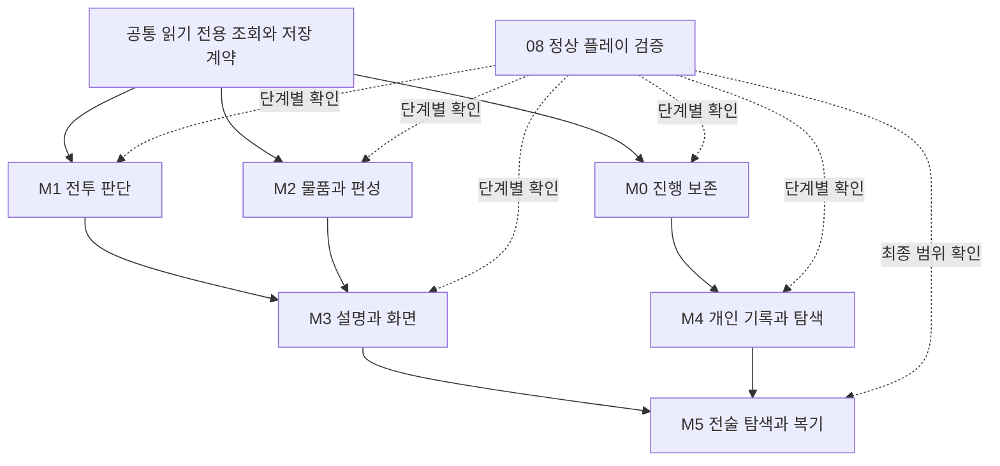

# 영걸전 우선순위와 상세 개발 계획

2026년 11월 9일 기준. [개발 예정 목록](../../BACKLOG.md)의 42개 항목을 구현 가능한 작업 단위로 나눴다. 이 문서는 우선순위와 의존성의 기준이며, 각 기능 문서는 화면 흐름·데이터·예외·완료 조건을 정의한다. **문서 작성 완료와 기능 구현 완료는 별개다. 코드 구현과 통합 검사를 진행했으며, 현재 범위·부분 구현·미검증 항목은 [개발 및 안정화 현황](implementation-status.md)에 기록한다. 42개 기능을 일괄 완료 처리하지 않는다.**

먼저 진행 손실을 줄이는 저장 작업과 작은 설명 기능을 제공하고, 이동 전 미리보기·위험도 지도·회복 수단 찾기를 붙인다. 캠페인 완주 검증은 처음부터 마지막까지 병행한다. 물품 관리와 출전 준비를 다음 묶음으로, 협공 탐색·리플레이·연습 모드는 기반이 안정된 뒤 진행한다.

## 문서 구성

- [공통 설계](architecture.md): 예측, 원본 규칙 조회, 확장 저장, 확정 사건, 화면 입력, 정보 검색의 소유자와 계약.
- [검증과 배포 전 완료 기준](verification.md): 합성 검사·정상 입력 재생·실제 창 조작·자료 보존의 구분.
- 아래 42개 기능 문서: 항목 번호를 유지해 작업·오류·검증 결과를 연결한다.
- [기존 구현 설명](../../README.md), [연구 근거 목록](../../research/README.md): 현행 구현과 자료 해석의 근거. 초기 연구 문서의 미구현 목록은 현재 소스와 대조한다.

문서 안의 새 타입·서비스·필드는 구현 제안이다. 현행 파일과 심볼은 별도로 적고, 존재하지 않는 제안 API를 이미 구현된 것으로 간주하지 않는다.

## 우선순위

| 등급 | 기준 | 개수 | 대표 과제 |
|---|---|---:|---|
| P0 | 진행 손실 또는 정상 진행 검증 공백을 해소 | 3 | 종료 시 중단 저장, 일반 저장 내구성, 캠페인 완주 검증 |
| P1 | 매 전투의 판단과 반복 조작에 직접 도움이 됨 | 14 | 이동 전 미리보기, 위험도, 회복 수단, 물품 관리, 출전 점검 |
| P2 | P1의 공통 기반을 활용해 판단 근거와 편의 확대 | 16 | 피해 근거, 성장 계획, 전투 요약, 편성 프리셋, 화면 설정 |
| P3 | 비용·자료 해석 범위가 크거나 기본 플레이 이후 효과가 큼 | 9 | 협공, 이벤트 힌트, 검색·기록 확장, 리플레이, 연습 |

P0는 개발상 우선순위이며 이미 발생한 장애의 심각도 표시가 아니다. 일반 저장의 두 파일 교체 위험은 정적 검토 사항이며, 현재 저장이 손상되었다는 뜻이 아니다.

## 첫 번째 개발 묶음

1. **12번의 최소 저장 개선**: 기존 슬롯 읽기, 상태와 메타데이터의 단일 교체, 빈 슬롯·손상 구분을 먼저 구현한다. 폴더 열기·일반 백업도 이어서 제공한다.
2. **07번 종료 시 중단 저장**: 기존 단일 소모형 중단 저장을 재사용한다. 종료 예약 중 실패·취소·중복 종료를 처리한다.
3. **09번과 26번 설명 기능**: 책략 사용 불가 이유와 상태 이상·회복 조건을 화면에서 바로 확인하게 한다. 저장 개선과 병행할 수 있다.
4. **08번 검증 경로 착수**: 정상 수치의 연속 입력 경로와 구간 체크포인트를 만든다. 이 장기 검증 때문에 읽기 전용 편의 기능의 개발을 기다리지 않는다.

이 묶음은 새 UI를 많이 만들기 전에 저장과 규칙 조회의 기준을 잡는다. 이어서 18·27번의 이동 정보와 01·02번의 전술 미리보기를 연결한다.

## 개발 단계와 통과 조건

| 단계 | 범위와 권장 진행 순서 | 다음 단계로 넘길 조건 |
|---|---|---|
| M0 진행 보존 | 12 → 07, 08 착수 | 기존 저장 호환, 실패 시 현재 게임 유지, 중단 저장 성공 후 소모. 08은 계속 진행 |
| M1 전투 판단 | 09·26·16 → 18·27·23 → 01·02 → 25, 34 병행 | 조회로 게임·난수가 바뀌지 않음, 숨김 정보 차단, 실제 클릭·취소 확인 |
| M2 물품과 편성 | 13 → 14·37, 15 → 35·36, 11, 33 | 중복 물품·가득 찬 가방·강제 출전 처리, 미리보기 무소모, 거래 실패 결과 일치 |
| M3 설명과 화면 | 17·05·04, 10·24·28, 20·22·21·30·38·40 | 예측과 실행 규칙 일치, 기록 중복 방지, 배율·포커스·모달·저장 회귀 통과 |
| M4 개인 기록과 탐색 | 19·29 → 39, 41·42·06 | 기록의 저장 소유자·상한·과거 저장 처리 확정, 미경험 사건·숨김 정보 차단 |
| M5 고비용 전술과 복기 | 03, 31·32는 각 선행조건 충족 후 병행 가능 | 탐색 상한, 재생 호환·결정성, 연습과 본편 저장 격리, 08의 완주 범위 보고 |

단계는 작업 묶음이다. 아래 표의 **필수 선행 기능과 공통 계약**이 충족된 작업은 병행할 수 있다. 예를 들어 M2의 물품 화면은 M1 전체 완료를 기다릴 필요가 없다. 08은 M0~M5에 걸쳐 지속하며, 정상 플레이 완주라는 표현은 실제 해당 경로의 완료 증거가 갖춰진 뒤 사용한다.

## 42개 기능 문서

필수 선행은 다른 신규 기능이 먼저 필요한 경우만 적는다. 비어 있는 항목도 개별 문서의 기존 기능·자료·공통 계약 조건을 충족해야 한다. 31·32번의 08 선행은 최소한 재생·연습 대상 전투의 정상 시작·종료와 결정적 재개 경로가 검증되어야 한다는 뜻이며, 모든 분기의 완주 완료를 요구하지 않는다.

| 번호 | 개발 문서 | 우선순위 | 단계 | 필수 선행 기능 |
|---|---|---|---|---|
| 01 | [이동 전 공격과 책략 미리보기](features/01.md) | P1 | M1 | 공통 계약·기존 기능 |
| 02 | [위험도 지도와 개별 적 위협 고정](features/02.md) | P1 | M1 | 공통 계약·기존 기능 |
| 03 | [협공 계산](features/03.md) | P3 | M5 | [01](features/01.md) · [02](features/02.md) · [17](features/17.md) |
| 04 | [범위 책략을 쓰기 좋은 위치 추천](features/04.md) | P2 | M3 | [01](features/01.md) · [09](features/09.md) |
| 05 | [장수 육성 도우미](features/05.md) | P2 | M3 | 공통 계약·기존 기능 |
| 06 | [선택형 전투 이벤트 힌트](features/06.md) | P3 | M4 | 공통 계약·기존 기능 |
| 07 | [창 닫기와 종료 시 중단 저장](features/07.md) | P0 | M0 | 공통 계약·기존 기능 |
| 08 | [새 게임부터 엔딩까지 연속 플레이 검증](features/08.md) | P0 | M0부터 지속 | 공통 계약·기존 기능 |
| 09 | [사용할 수 없는 책략의 이유 표시](features/09.md) | P1 | M1 | 공통 계약·기존 기능 |
| 10 | [전투 종료 보고서와 누적 전적](features/10.md) | P2 | M3 | 공통 계약·기존 기능 |
| 11 | [전직을 미리 보는 성장 계획](features/11.md) | P2 | M2 | 공통 계약·기존 기능 |
| 12 | [저장 관리와 일반 저장 내구성 개선](features/12.md) | P0 | M0 | 공통 계약·기존 기능 |
| 13 | [전체 소지품 관리 화면](features/13.md) | P1 | M2 | 공통 계약·기존 기능 |
| 14 | [장비 구매와 교환 전 능력치 비교](features/14.md) | P1 | M2 | [13](features/13.md) |
| 15 | [출전 준비 점검](features/15.md) | P1 | M2 | 공통 계약·기존 기능 |
| 16 | [부대 목록 정렬과 필터](features/16.md) | P1 | M1 | 공통 계약·기존 기능 |
| 17 | [예상 피해의 계산 근거 설명](features/17.md) | P2 | M3 | 공통 계약·기존 기능 |
| 18 | [이동 중 지형 정보 표시](features/18.md) | P1 | M1 | 공통 계약·기존 기능 |
| 19 | [지도 메모와 작전 표시](features/19.md) | P3 | M4 | 공통 계약·기존 기능 |
| 20 | [중요한 전투 연출만 보기](features/20.md) | P2 | M3 | 공통 계약·기존 기능 |
| 21 | [전장 전체 보기와 지도 확대 및 축소](features/21.md) | P2 | M3 | 공통 계약·기존 기능 |
| 22 | [조작과 가독성 설정](features/22.md) | P2 | M3 | 공통 계약·기존 기능 |
| 23 | [전투 목표 추적 패널](features/23.md) | P1 | M1 | 공통 계약·기존 기능 |
| 24 | [적 턴 종료 후 변화 요약](features/24.md) | P2 | M3 | 공통 계약·기존 기능 |
| 25 | [부상한 장수를 회복할 방법 찾기](features/25.md) | P1 | M1 | [01](features/01.md) · [09](features/09.md) |
| 26 | [상태 이상 설명과 해제 안내](features/26.md) | P1 | M1 | 공통 계약·기존 기능 |
| 27 | [이동할 수 없는 이유 표시](features/27.md) | P1 | M1 | 공통 계약·기존 기능 |
| 28 | [이어하기 직후 진행 요약](features/28.md) | P2 | M3 | 공통 계약·기존 기능 |
| 29 | [캠페인 여정과 선택 기록](features/29.md) | P3 | M4 | 공통 계약·기존 기능 |
| 30 | [상황별 초보 안내](features/30.md) | P2 | M3 | [09](features/09.md) · [26](features/26.md) |
| 31 | [전투 다시 보기](features/31.md) | P3 | M5 | [08](features/08.md) |
| 32 | [클리어한 전투 연습 모드](features/32.md) | P3 | M5 | [12](features/12.md) · [08](features/08.md) |
| 33 | [상점 장바구니와 여러 개 구매](features/33.md) | P2 | M2 | [13](features/13.md) · [37](features/37.md) |
| 34 | [앱을 벗어났을 때 자동 일시정지](features/34.md) | P1 | M1 | 공통 계약·기존 기능 |
| 35 | [두 장수 나란히 비교](features/35.md) | P2 | M2 | 공통 계약·기존 기능 |
| 36 | [출전 편성 프리셋](features/36.md) | P2 | M2 | [15](features/15.md) |
| 37 | [중요한 물품 보호 표시](features/37.md) | P1 | M2 | [13](features/13.md) |
| 38 | [자주 쓰는 책략과 도구 즐겨찾기](features/38.md) | P2 | M3 | [09](features/09.md) |
| 39 | [대사 기록 검색과 북마크](features/39.md) | P3 | M4 | 공통 계약·기존 기능 |
| 40 | [마을 시설과 대화 상대 찾기](features/40.md) | P2 | M3 | 공통 계약·기존 기능 |
| 41 | [방문한 상점의 판매 물품 기록](features/41.md) | P3 | M4 | 공통 계약·기존 기능 |
| 42 | [장수와 물품 및 책략 통합 검색](features/42.md) | P3 | M4 | 공통 계약·기존 기능 |

## 개발 작업에 붙일 완료 기록

각 작업의 상태는 설계, 구현 중, 검증 중, 완료로 구분한다. 완료 기록에는 변경 소스, 통과한 기능별 기준, 저장 호환 범위, 실제 OS 입력 검증 여부, 남은 경계와 로컬 증거 위치를 적는다. 실패하거나 건너뛴 검사를 통과로 표시하지 않는다.

현행 기능을 재개발하지 않도록 기존 상태에서 시작한다. 책략 습득표·개별 공격 예측·일반 적 위협·현재 전투 기록·전직 비교·중단 저장은 이미 있으며, 새 항목은 그 범위를 확장한다. 코드 작업에 앞서 각 문서가 참조하는 심볼과 호출 순서가 여전히 맞는지 확인한다.

